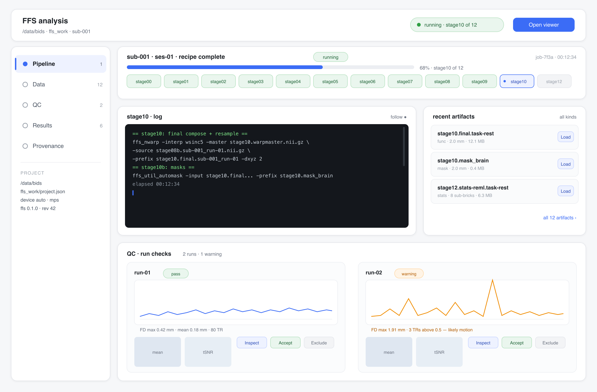
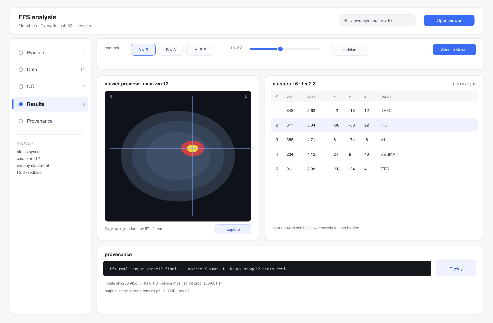
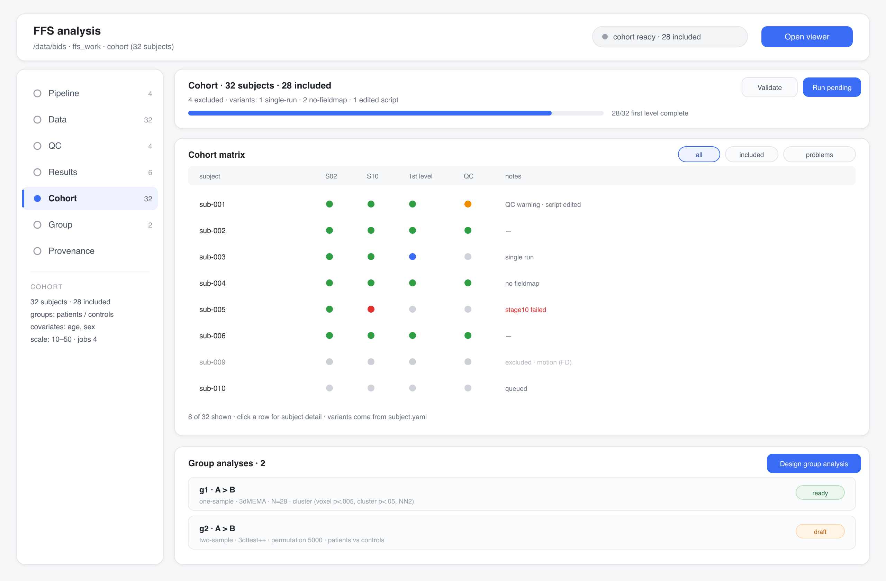

# Analysis inspection UI

Status: **draft for review** — the UI half of [WORKFLOW.md](WORKFLOW.md).

**U0 implementation:** [`ffs-analysis-ui/`](../ffs-analysis-ui/) is installed as a bundle. Its
Host half serves a fixture snapshot built from the ds005165 run; its Client half is the
right-sidebar **FFS analysis** tab (pipeline, data, QC, results, cohort, group, provenance).
Only "Load in viewer" is live. Open it from **Analysis** in the Session header, or from the
sidebar tab guide; agent tool `ffs_analysis_show` reveals it.

The workflow design covered execution, provenance, and plugin contracts. This document
covers what the user actually looks at: a dedicated inspection surface for the pipeline,
the data, QC, the results, and the provenance — and how it drives the existing viewer
instead of duplicating it.







Source wireframes: [analysis_ui.svg](analysis_ui.svg), [analysis_results.svg](analysis_results.svg),
[analysis_cohort.svg](analysis_cohort.svg).

## 1. Goal and non-goals

**Goal.** Inspect an analysis without leaving the Harness window and without hand-writing
viewer commands:

- which subjects are in, which are excluded and why, and which variants were used;
- what the pipeline is doing right now, stage by stage;
- which runs pass QC and which do not;
- which artifacts exist, what they are, and one click to see them;
- which contrasts/clusters came out, and one click to jump the viewer to a peak;
- exactly what produced a file, and how to reproduce it.

**Non-goals.** Reimplementing image rendering (the viewer owns it), a general statistics
workbench, free-form plotting from model text. The inspection UI is a **client of the
viewer and the manifest**, not a second viewer.

## 2. Surfaces

| # | Surface | Slot / API | Purpose |
|---|---|---|---|
| S1 | **FFS analysis** right-sidebar tab | `sidebarRightTabs.register` + `sidebar.right.pane.tab` | the full inspector (this document) |
| S2 | Header button **Analysis** | `conversation.session.header.utilities` | opens/reveals S1, next to the existing viewer button |
| S3 | Rich tool cards | `tool.call.toolview`, keyed by tool name | run/QC/result summaries inline in chat |
| S4 | Turn-tail card | `conversation.chat.turnTail` | "analysis changed in this turn" summary with an open action |
| S5 | Settings page | `settings.section` | python/project/device/recipe defaults |
| S6 | In-viewer inspector (later) | viewer pane kind or `shell.overlay` | side-by-side inspection without switching tabs |

The viewer keeps its own tab; S1 is a **sibling tab** in the same right sidebar, so the
analysis panel and the images are one click apart, and every inspection action can switch
to, or command, the viewer.

## 3. Layout

```
┌ FFS analysis ─────────────────────────────────────────────────────────────┐
│ /data/bids · sub-001                ● running stage10/12   [Open viewer]  │
├──────────────┬────────────────────────────────────────────────────────────┤
│ ▸ Pipeline   │  sub-001 · complete recipe        job-… · 00:12:34         │
│ ▸ Data       │  ████████████████████░░░░  68%                             │
│ ▸ QC         │  [stage00][stage01]…[stage10]*[stage12]                     │
│ ▸ Results    │  ┌ stage10 log ──────────────┐ ┌ recent artifacts ───────┐ │
│ ▸ Cohort     │  │ == stage10: compose ==     │ │ stage10.final… [Load]   │ │
│ ▸ Group      │  │ ffs_nwarp -interp wsinc5…  │ │ stage10.mask… [Load]    │ │
│ ▸ Provenance │  └────────────────────────────┘ └─────────────────────────┘ │
│              │  ┌ QC · run checks ────────────────────────────────────┐   │
│              │  │ run-01 pass  ～～～～FD plot～～～～  [accept][exclude]│   │
│              │  │ run-02 warn  ～～～～FD plot～～～～  [accept][exclude]│   │
│              │  └─────────────────────────────────────────────────────┘   │
└──────────────┴────────────────────────────────────────────────────────────┘
```

Left rail sections: **Pipeline · Data · QC · Results · Cohort · Group · Provenance**. The
rail shows counts (pipelines, artifacts, warnings, contrasts, subjects, group analyses) and
switches the content pane without losing selection context (selected artifact/run/subject/
contrast survives section switches). Cohort and Group are **cohort-scoped**; the other
sections are filtered by the currently selected subject.

## 4. Section content

### Pipeline
- Run cards: subject/session, recipe, flags, status, elapsed; one card per pipeline attempt.
- **Stage timeline**: chips for the emitted stages (`stage00`…`stage12`, plus `stage10s`/`stage12s`
  when surfaces are on) with `done / running / skipped / failed / pending`; click a chip for
  duration, command line, and that stage's log window.
- Live progress from the DSH job: bar, current stage, elapsed, and a **Cancel** action.
- Actions: `Plan`, `Run`, `Resume`, `Open script`, `Replay stage`, `Reveal work dir`
  (via the existing open-in-app service).
- Failure: red chip + the last 40 log lines + the failing command, with "hand to agent".

### Data
- Artifact table: filter by kind/space/stage/subject; columns name, kind, space, stage,
  size, produced-by; sortable; multi-select.
- Preview pane: a thumbnail (sagittal/coronal/axial strip) rendered server-side and cached
  by content hash; for 4-D, a volume slider.
- Actions: **Load in viewer**, **Load & show**, copy path, reveal in Finder, register into
  a report. Loads go through `ffsViewer.loadArtifacts` → the viewer's validated `LOAD` path,
  so `analysis.ffs` stays truthful.
- Badges: `underlay`, `overlay`, `stats`, `surface`, `qc` from the artifact `hint`.

### QC
- One card per run/session: framewise displacement plot, tSNR summary, mean image
  thumbnail, alignment overlay; a one-line verdict from `ffs_qc_table` thresholds.
- Verdict controls **accept / exclude**; exclusions are written to the manifest
  (`exclusions[]`) and visibly propagate to downstream run lists.
- Sort/filter by warning level; "show excluded" toggle.
- All plots are server-rendered PNGs (numpy/PIL in the compute sidecar), not client charts:
  one renderer, identical output in the report, no plotting dependency in the browser.

### Results
- Contrast list (from stage12 or `ffs_util_concalc`): name, model, stat, threshold, dof.
- Preview: the viewer's current render (`ffs_viewer_render`) at the selected contrast,
  with the crosshair drawn; a "show in viewer" hand-off keeps it live.
- **Cluster table**: id, size, peak t, x/y/z, region; sortable; clicking a row issues
  `SET_XYZ`/`SET_INDEX` through the viewer service, so the image and the table agree.
- Threshold/colormap controls issue `SET_THRESHOLD`/`SET_COLORMAP` on the stats layer
  (debounced); the viewer remains the authority, the panel is a remote control.
- Screenshot: "capture" writes `ffs_viewer_render` output into the artifact list as
  `kind: "screenshot"` so the report reuses exactly what was inspected.

### Cohort
- Header: subjects total/included/excluded, variant summary, first-level completion.
- **Matrix**: one row per subject, columns for the key stages (`S02`, `S10`, `1st level`,
  `QC`, group-relevant contrasts) with status dots; the notes column carries the variant
  (`single run`, `no fieldmap`, `script edited`) and the exclusion reason.
- Row click opens subject detail (Pipeline/QC/Results filtered to that subject).
- **Include / exclude** toggles write `cohort.yaml` + manifest; excluded rows stay visible,
  dimmed, never silently dropped.
- **Validate** runs `ffs_cohort`: missing outputs, grid/mask mismatches, engine
  availability; problems list the exact subject and reason.
- **Run pending** starts a bounded-parallel subject job (`--jobs 4`), progress per row.
- Filters: all / included / problems; search by subject; sort by status.

### Group
- Analysis cards: contrast, design (one-sample / two-sample / covariates / repeated /
  custom), engine (`3dMEMA` / `3dttest++` / `flame` / `custom`), N, correction (method +
  parameters), status.
- **Design group analysis** form: contrast, design, include set (from the cohort), groups,
  covariate columns, engine, correction. Saves to `group.yaml` + manifest; a dry-run
  preview shows the exact engine command before running.
- Results: group cluster table (size, peak, x/y/z, region), threshold controls, viewer
  preview/render; clicking a cluster sets the viewer crosshair through the same service as
  Results.
- Engine/correction availability badges (AFNI/R/FSL) come from the doctor; choosing an
  unavailable engine disables Run with the reason.
- **Settle** is enabled only when every included subject's first-level output and every
  group analysis has a result or an explicit skip decision.

### Provenance
- The pipeline script (syntax-highlighted, read-only) and the exact command for the
  selected artifact.
- Inputs/outputs with sha256, FFS version, device, environment; manifest revision.
- **Replay**: copy the command, re-run a stage, or reproduce the artifact; records a new
  attempt rather than overwriting history.
- **Analysis package**: a checklist card — settled · cohort · group · scripts frozen ·
  hashes · methods lint · figures — with a style selector, include-figures/viewer-state
  toggles, **Export**, progress, and the result with "Open folder". Disabled until the
  analysis is settled. Design: [REPRO_PACKAGE.md](REPRO_PACKAGE.md) §10.
- "Why can't I…" hints when a stage is missing because an upstream stage was skipped.

## 5. Slot map (verified against the running Harness)

| Contribution | Registration | Notes |
|---|---|---|
| tab type + guide | `ctx.sidebarRightTabs.register({id, kind, title, keepMounted, guide})` | same pattern as the viewer tab; separate kind `ffs-analysis` |
| tab body | `ctx.slots.inject('sidebar.right.pane.tab', () => ctx.slots.register({name, key, locale}, Body))` | key = tab id |
| header button | `ctx.slots.inject('conversation.session.header.utilities', …)` | order after the viewer button |
| tool cards | `ctx.slots.inject('tool.call.toolview', () => ctx.slots.register({name:'tool.call.toolview', key:'ffs_pipeline_run'}, …))` | keyed by wire name; open key domain |
| turn tail | `ctx.slots.inject('conversation.chat.turnTail', …)` | one small card, not a dump |
| settings | `ctx.slots.inject('settings.section', …)` | defaults for python/project/device/recipe |
| optional overlay | `ctx.slots.inject('shell.overlay', …)` | floating inspector, if S6 is wanted |

Custom tool cards are the cheapest high-value surface: the model's run/QC/result calls
become visual, and the agent's prose stays short.

## 6. Data and transport

The UI reads a **snapshot projection** owned by the compute Host half; it never parses
session logs or NIfTI in the browser.

```
GET  /ffs-analysis/snapshot?project=<id>&rev=<n>   → {rev, project, pipelines, artifacts, qc, results, job}
GET  /ffs-analysis/artifact/<id>                   → artifact detail + provenance
POST /ffs-analysis/load                            → viewer load (via service) + screenshots
POST /ffs-analysis/run | cancel | exclude | replay → mutation, returns new rev
POST /ffs-analysis/settle | export | methods       → settle/export; export returns the package
GET  /ffs-analysis/package/<id>                    → checklist + validation per item
GET  /ffs-analysis/cohort                          → subject matrix, variants, problems
POST /ffs-analysis/cohort/validate | include | exclude → mutation, returns new rev
POST /ffs-analysis/group/plan | run | cancel       → group analysis lifecycle
```

- Same authenticated-route pattern as the viewer (`ctx.inject(['webServer','connection'])`,
  `ctx.connection.admit(req)`, Connection result envelope) — the reason the viewer uses a
  raw route is documented in [API.md](API.md), and it applies again here.
- **Polling, not streaming, for v1**: 1 s while a job runs, 5 s idle, immediate after a
  mutation. The snapshot carries `rev`, and unchanged revs cost one conditional request.
  SSE on the same route is the upgrade path if 1 s feels coarse.
- The snapshot is bounded: ≤ 100 artifacts per page, ≤ 200 log lines, thumbnails as URLs.
  Detail and logs are fetched on demand.
- Client state: one small store per tab (`useSyncExternalStore` or a plain emitter), with
  section selection and selection ids kept locally; all scientific/display state stays in
  the manifest and the viewer.

## 7. Component inventory

`AnalysisTab` (shell) · `ProjectHeader` · `StatusPill` · `SectionRail` · `RunCard` ·
`StageTimeline` · `StageChip` · `LogTail` · `ArtifactTable` · `ArtifactPreview` ·
`LoadControls` · `QcRunCard` · `FdPlot` · `VerdictControls` · `ContrastList` ·
`ClusterTable` · `ThresholdControls` · `CohortMatrix` · `SubjectRow` · `VariantBadge` ·
`GroupAnalysisCard` · `GroupDesignForm` · `EngineSelector` · `CorrectionSelector` ·
`GroupClusterTable` · `ProvenancePanel` · `PackageCard` · `ReplayBar` · `ToolCard` ·
`TurnCard` · `AnalysisSettings`.

Plain React + host theme tokens; no Client package imports (practices rule). The viewer
bundle already demonstrates the pattern (`slots.inject` + one namespaced stylesheet +
locale namespace).

## 8. States and errors

- **No project**: onboarding card → scan a BIDS root or open an existing project.
- **Scanning / planning**: skeleton rows, progress, cancel.
- **Running**: live timeline; the rest of the panel stays usable.
- **Failed**: red banner with stage + last log lines; "retry stage" / "hand to agent".
- **Stale viewer**: the viewer's rev is behind the manifest → "load latest" chip.
- **Env missing**: doctor checklist with the missing dependency and its install hint.
- **Empty section**: one sentence plus the action that fills it (never a blank panel).

## 9. Design system and accessibility

- **Same design language as the FFS viewer.** The analysis tab reuses the viewer's measured
  values rather than inventing new ones: `12px/1.4` system font stack, 6 px shell padding,
  `4px 6px` header, 6 px-radius buttons with brand hover, 9 px cards with a `layer2` header
  band and 10 px uppercase tracked card titles, 999 px count pills, `layer2` row hover and
  brand active borders.
- Only `--dsw-alias-*` theme tokens for chrome; the FFS colormap palette is used only
  inside data plots.
- Locale namespace `ffs-analysis` (en + zh), sentence case.
- Keyboard: `↑/↓` rows, `Enter` load/open, `Esc` close detail, `/` filter; visible focus
  ring from host tokens.
- Tables use real table semantics; stage chips expose `aria-label` with state; live
  progress uses `aria-live="polite"` and does not spam.
- Narrow sidebar (< 420 px): rail collapses to icons, cards stack, table drops columns
  (never horizontal scroll for the primary action).

## 10. Tight-viewer interactions

| From | Action | Viewer effect |
|---|---|---|
| Data row | Load | `LOAD` + `hint` (colormap/threshold/role) |
| QC card | Inspect | loads mean + mask, sets crosshair to motion peak |
| Cluster row | Jump | `SET_XYZ` `SET_INDEX` on the stats layer |
| Threshold slider | Tune | `SET_THRESHOLD` (debounced 60 ms) |
| Capture | Screenshot | `ffs_viewer_render` → `screenshot` artifact |
| Open viewer | Switch tab | `sidebarRight.openTab('ffs-viewer')` |

All of these go through the viewer service, hence through the FFS command bus: the panel
never writes viewer state, and the image and the tables cannot disagree.

## 11. UI milestones

| Milestone | Ships | Proof |
|---|---|---|
| **U0** (with M0) | settings page, tab shell, artifact list from the manifest | tab opens, lists the fixture, loads one artifact |
| **U1** (with M1) | pipeline timeline + script view + plan/run actions | plan visible and reviewable before execution |
| **U2** (with M2) | live job progress, log tail, cancel, QC dashboard, load-to-viewer | a running fixture pipeline inspected end to end; screenshot artifact |
| **U3** (with M3) | results inspector: contrasts, clusters, threshold, crosshair; provenance/replay; analysis-package card (settle/export/methods/validation) | click a cluster, viewer jumps; replay reproduces an artifact; export validates |
| **U4** (with M4) | cohort section: matrix, subject detail, variants, include/exclude, validate, run-pending | variant subjects visible; missing-output and grid-mismatch shown per subject |
| **U5** (with M5) | group section: analysis cards, design form, engine/correction selectors, group cluster table, viewer sync | one-sample and two-group fits inspected; an unavailable engine is disabled with a reason |
| **U6** | tool cards, turn tail, optional in-viewer inspector, locale/a11y polish | run/QC/group calls render as cards |

## 12. Open questions

- **Second tab vs. pane inside the viewer.** S1 is the low-risk v1; S6 (docked pane beside
  the slices) is the nicer end state but requires the viewer to declare a pane kind/slot.
  Decide after U2 shows how often users switch tabs.
- **Live logs.** Polling is simple; if pipeline runs are long and the log is the main
  thing being watched, SSE is worth it early.
- **QC plots server-side vs. client SVG.** Server PNGs are consistent and report-ready;
  client SVG would allow hover/zoom. Default: server PNG, revisit if interaction is needed.
- **Cohort matrix density.** At 50 subjects the matrix needs virtualization and a compact status column; revisit the wireframe after U4.
