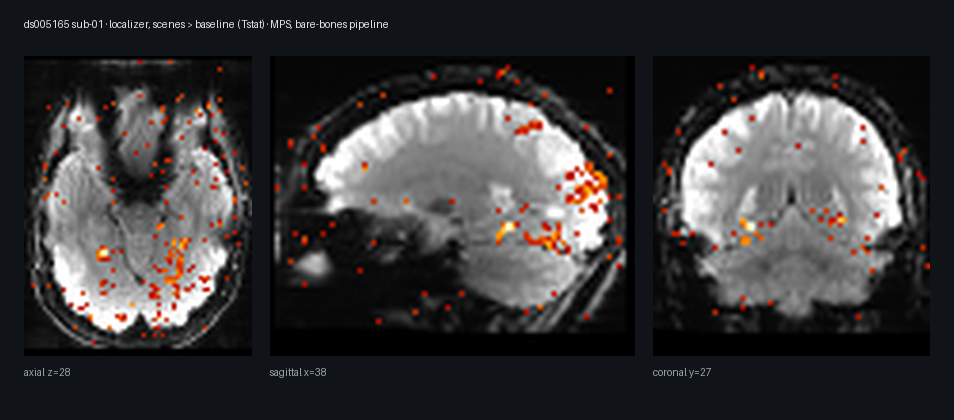
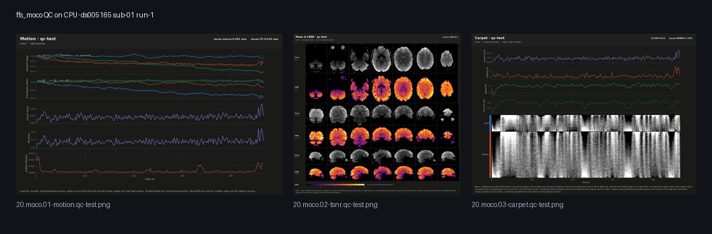

# Real-data test — OpenNeuro ds005165 (BOLD Moments, sub-01)

Status: **done** (2026-11-12), branch `analysis-suite`.

This is the first end-to-end run of the FFS stack on real data from inside this checkout. It
tests the assumptions the analysis suite is designed around (BIDS scan → plan → frozen
script → execution → stats → viewer), and surfaces the environment checks the `doctor` step
must perform.





## Dataset and subset

- **OpenNeuro ds005165**, BOLD Moments Dataset, sub-01, ses-01. 3 T Siemens Prisma,
  TR 1.75 s, 2.5 × 2.5 × 2.75 mm, 76 × 76 × 54 matrix, 268 volumes/run.
- Downloaded **361 MB**: `T1w` + localizer run-1/run-2 (`_bold.nii`, `.json`,
  `_events.tsv`) + `dataset_description.json` + `participants.tsv`. The full session is
  1.54 GB; the subset keeps the test small while exercising two runs and a 5-condition
  localizer.
- Local paths: `data/real/ds005165/` (gitignored), work dir `work/ds005165/sub-01/`
  (gitignored).

## What ran

1. **CLI shim.** The reference clone is not pip-installed, and the generated pipeline calls
   `ffs_*` by name. 86 wrappers were generated from
   `reference/fastfuncstuff/pyproject.toml` `[project.scripts]`:

   ```bash
   #!/bin/bash
   export PYTHONPATH="<repo>/python:<repo>/reference/fastfuncstuff${PYTHONPATH:+:$PYTHONPATH}"
   exec "<repo>/.venv/bin/python" -m <module> "$@"
   ```

   written to `work/bin/` and put on `PATH`. This is exactly what the suite's `doctor`
   must automate.

2. **Plan** (no execution), `-recipe bare_bones -no_qc`:

   ```bash
   PYTHONPATH=python:reference/fastfuncstuff .venv/bin/python -m \
     fastfuncstuff.cli.autoproc -bids_dir data/real/ds005165 -subject 01 -session 01 \
     -task localizer -recipe bare_bones -no_qc \
     -work_dir work/ds005165/sub-01 -out work/ds005165/sub-01/proc_sub-01.sh
   ```

   Result: 383-line resumable script, stages `02, 06, 07, 08, 10a, 10, 10b, 12`;
   `stage11.design.task-localizer.toml` with 6 events (bodies, faces, fix, objects, scenes,
   scrambled), SPMG1, **no contrasts** (as documented); events copied to `stimuli/`.

3. **Run** on MPS:

   ```bash
   PATH=$PWD/work/bin:$PATH bash work/ds005165/sub-01/proc_sub-01.sh 2>&1 | tee .../proc_sub-01.log
   ```

   `00:02:45 (165 s)` total, exit 0. Stage timings: moco 29.5 s + 13.2 s; cross-run/means
   seconds; final resample 32.7 s + 11.0 s; masks 0.3 s; `ffs_reml` ~40 s (117 ARMA pairs,
   82 per-voxel groups). 263,417 in-mask voxels, mean R² 0.268, mean |t| 1.187.

4. **QC** — MPS fails in the QC plotting path; CPU succeeds:

   ```bash
   PATH=$PWD/work/bin:$PATH MPLCONFIGDIR=/tmp/mpl-cache ffs_moco \
     -input ...run-1_bold.nii -base 0 -cost wls -twopass \
     -save_mean /tmp/qc_test_mean.nii.gz -qc /tmp/qc_test -qc_label qc-test -device cpu
   ```

   51.1 s → `20.moco.01-motion.qc-test.png`, `02-tsnr`, `03-carpet`, plus metrics records.

## Outputs

| Artifact | Size | Notes |
|---|---|---|
| `stage10.final.ses-01.task-localizer.run-{1,2}.nii.gz` | 250 / 251 MB | final 4-D, 2.5 mm |
| `stage10.final.*_mean.nii.gz` | ~1 MB each | viewer underlay |
| `stage12.stats-reml.task-localizer.nii.gz` | 12 MB | 13 sub-bricks: `Full_Fstat` + 6 × `Coef`/`Tstat` |
| `stage12.stats-ols…`, `…_ffsremlvar.nii.gz` | 12 / 3.2 MB | OLS comparison + ARMA params |
| work dir total | 552 MB | |

Peak `scenes#0_Tstat` = **8.78** at `ijk (38, 27, 28)`; shown in the viewer at threshold 3.1,
`hot` colormap, positive sign, over the run-1 mean. Load path: `LOAD`/`SET_UNDERLAY`/
`SET_OVERLAY`, then `SET_VOLUME` to pick the sub-brick — the exact artifact→viewer seam the
design assumes, exercised on real data.

## Environment findings → design implications

1. **FFS is not installed; the script needs a shim.** `doctor` must verify the interpreter,
   `fastfuncstuff` import, **and every `ffs_*` entry point the frozen script calls** (parse
   the script, don't assume). The suite should generate the PATH shim (or require an
   installed package) before planning.
2. **QC needs `matplotlib` and a writable `MPLCONFIGDIR`.** Neither was present; the first
   run failed mid-batch with `No module named 'matplotlib'`. Install + `MPLCONFIGDIR` must
   be doctor checks.
3. **QC on MPS fails with a float64 error** (`Cannot convert a MPS Tensor to float64`), while
   the same QC succeeds on CPU. The suite must route QC stages to CPU (or pass `-no_qc` on
   MPS and run QC separately). This is a concrete engine/device rule, not a theoretical one.
4. **`-no_qc` is a clean escape hatch**: the full preprocessing + GLM run completed without
   QC, so the pipeline and QC are separable stages — which matches the design's QC-phase
   boundary.
5. **Real-data runtime is laptop-friendly**: 2 runs × 268 volumes, full bare-bones pipeline
   in 2:45 on MPS. A 10–50 subject cohort is hours, not days, with bounded parallelism.
6. **The stats bucket is group-ready**: per-condition `Coef`/`Tstat` sub-bricks are exactly
   what `3dMEMA` consumes — the M4/M5 cohort/group design has the right input shape.
7. **Design spec has no contrasts by default**; the suite's `ffs_glm`/`ffs_contrast` must add
   them (edit the spec or `ffs_util_concalc`), which is already in the plan.
8. **macOS specifics**: Bash 5 (Homebrew) is required by the generated script; `zstd`/`pigz`
   are present; matplotlib fontconfig warns without a writable cache, which is only noise.

## Reproduce

```bash
# data (subset)
aws s3 cp --no-sign-request s3://openneuro.org/ds005165/dataset_description.json data/real/ds005165/
aws s3 cp --no-sign-request s3://openneuro.org/ds005165/sub-01/ses-01/anat/sub-01_ses-01_T1w.nii data/real/ds005165/sub-01/ses-01/anat/
# … run-1/run-2 bold + json + events, as in §Dataset

# shim, plan, run, QC, viewer: see §What ran and the commands in the log
```

The pipeline log is at `work/ds005165/sub-01/proc_sub-01.log` (gitignored).
