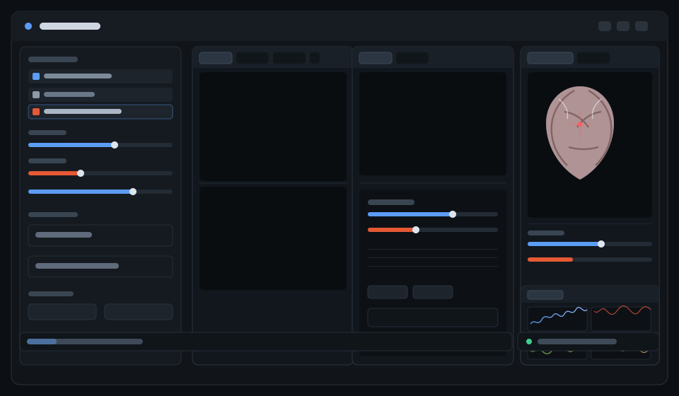

# FFS fMRI viewer

One interactive fMRI workspace docked in the DeepSeek Harness right Sidebar, built on the
[fastfuncstuff](https://github.com/dowdlelt/fastfuncstuff) viewer: its datasets, layers,
modes, controllers and viewports are preserved, but its separate desktop windows are
consolidated into one resizable workspace with docked and tabbed panes.

## Open it

The viewer is a **docked tab in the right Sidebar**. Click **FFS viewer** in the Session
header (beside the other utilities), or open the right Sidebar and pick the FFS viewer
capsule from its guide. The Sidebar's own controls resize it, split its panes and switch
it to fullscreen; inside the tab, the FFS workspace's panes dock, tab, split, resize and
maximize. The tab is revealed when an agent runs `ffs_viewer_show`.

## Controls rail

The left rail is a card inspector: a compact header with Data, collapsible Layers,
Display, Time, Navigate and Scene cards, a two-level Display card (primary controls +
Advanced), segmented Sign/outline controls, and a fixed Save/Restore footer. Layer rows
carry visibility, swatch, middle-truncated filename, key and volume count; the rail is split into **Colour** (selected layer, colormap, opacity, sign, horizontal
range bar with min/max + Auto + mirror/fixed/reverse) and **Overlay** (OLAY shown
sub-brick, THR ON threshold sub-brick with same/+1/+2/fixed follow, threshold on/off +
numeric entry/slider, alpha, boxed/edges/time-linked, and time-view detrend/PSC under
Advanced); hovering a
row shows the complete path instantly and double-clicking copies it; the eject button on each
row (and **Unload** in the selected-layer header) removes it with `REMOVE_LAYER`.

## Loading data

Nothing is loaded at launch. **Data sources…** in the viewer header (or the control rail or
the empty-state card) opens the FFS-style data picker:

- add/remove/read/rescan **folders** (persisted in `sources.json`, optional recursive);
- pick from the folder's **catalog** (anat / func / stats / mask, with shape, TR and
  sub-brick labels), filtered by kind chips with live counts; each row shows a middle-truncated filename with metadata on a second line and reveals the full path in the footer on hover; a click previews, **Load** commits;
- add/remove **FreeSurfer subjects** and load their surfaces.

Folder paths may be pasted as absolute or project-relative. Agent equivalents:
`ffs_viewer_sources` and `ffs_viewer_load`.

## Layout

**＋ Add viewer** creates image/graph/surface viewports in a new floating window. The
menu chooses the data source (all visible layers or one solo layer); ⚙ → Data changes
it later. Views share the session stack; a solo view displays the globally selected
layer.

Panes are floating windows with only snap and resize:

- **Move** — drag the title bar; windows are free-floating and may overlap.
- **Snap (modifier-only)** — hold **Shift** inside the 16 px edge/corner band to
  highlight that half/quarter; release with Shift down to snap. Without Shift the drag
  always free-places, even at an edge.
- **Resize** — drag an edge/corner or the ◢ grip.
- **Minimize** — **–** sends a window to the bottom taskbar; click its chip to restore.
- **Focus** — clicking a window raises it above the others; newly added windows open in front.

Positions/sizes persist in `workspace.json`; there is no fixed slot grid. Each window has tabs; ⚙ per-view settings
and ✕ close-tab remain in the pane header. Tabs read Viewer 1 / Viewer 2 / … (FFS ids
remain V1/V2 in commands/tooltips), and surface panes carry a Flatten/Inflated button
when a flat patch exists; the shape transition mirrors `surfacewindow.py`'s 450 ms
InOutCubic morph.

Graph 1 defaults to a single cell: one trace per visible 4-D layer, so adding another
4-D run adds another colored trace rather than another cell. Click or drag
horizontally across the graph to scrub the shared time index (one in-flight update,
latest pointer position wins). Grid density remains adjustable in ⚙.

## What the prototype demonstrates

- **Embedded slice views** — axial, sagittal and coronal panes rendered by FFS's own
  `compose.render_viewport`, including colormap, range, sign mode, threshold sub-brick,
  alpha fade and boxed edges. Click moves the crosshair; drag pans; wheel zooms.
- **Interactive surface view** — FFS surface geometry (`surface3d.shape_positions`,
  layout, split/hinge) with per-vertex colours sampled by
  `surface.profiles.sample_depths` (white→pial, equivolume), reduced with
  `surface3d.reduce_depth` and coloured with `surfacelayers.layer_rgba`. Clicking a
  vertex is resolved by FFS's `surface3d.pick` in the sidecar and links the crosshair.
- **Linked time-series view** — the graph grid follows
  `viewer/ui/gridgraph.py`'s cells around the crosshair; each cell plots the FFS
  `timeseries()` of every time-linked layer, detrended by `viewer.derive.detrend_trace`.
  Clicking scrubs time.
- **Independent viewport identities and duplicates** — every pane names a real FFS
  `Viewport` id; duplicate, split, park, lock, zoom-link and per-view settings are
  commands.
- **Parked reference slices** — unlock a pane and park it on a slice while the other
  panes keep following the crosshair.
- **Persistent layouts** — workspace docks/tabs/sizes and the FFS viewer script are
  saved together; the layout is stored separately because it is not scientific state.
- **Display vs analysis vs source** — revision chips and the saved manifest distinguish
  cosmetic display changes from analysis and source-data changes.

## One validated command interface

The pane controls and the agent tools call the same endpoints:

- Tools: `ffs_viewer_command`, `ffs_viewer_state`, `ffs_viewer_load`,
  `ffs_viewer_sources`, `ffs_viewer_workspace`, `ffs_viewer_show`,
  `ffs_viewer_render`, `ffs_viewer_save`, `ffs_viewer_debug`,
  `ffs_viewer_parity`.
- Command examples: `SET_IJK 32 40 25`, `SET_THRESHOLD S 3.2`, `SET_ALPHA S linear`,
  `OPEN_VIEW V4 image sagittal`, `SET_VIEW_LOCKED V4 0`, `SET_VIEW_POSITION V4 20`,
  `SET_SURFACE_DEPTH S1 0.1 0.9 5`, `SET_VIEW_GRID G1 2`.

Every line is parsed by the original `viewer.commands.parse_line`, so the full 114-command
vocabulary is accepted, typed and replayable. A command from the browser is recorded with
origin `ui`; one from a tool with origin `agent`.

## Requirements

- The sidecar runs from this checkout: `python/` plus `reference/fastfuncstuff` on
  `PYTHONPATH`, using `<project>/.venv/bin/python`. Override `pythonPath`, `projectRoot`
  or `stateDir` in the bundle configuration if installed elsewhere.
- Demo data is generated by `scripts/build_demo_data.py` into `data/demo/`.

## Limits of this prototype

The rendering architecture is deliberately evaluated before expanding the feature set:
slice panes are server-rendered PNGs (authoritative but one round-trip per change), the
surface view is a WebGL2 renderer over FFS geometry (fast interaction, server-side
picking), and the graph is a canvas plot over FFS series. A full parity tracker is in
`docs/PARITY.md`; the architecture evaluation is in `docs/RENDERING_EVALUATION.md`.
